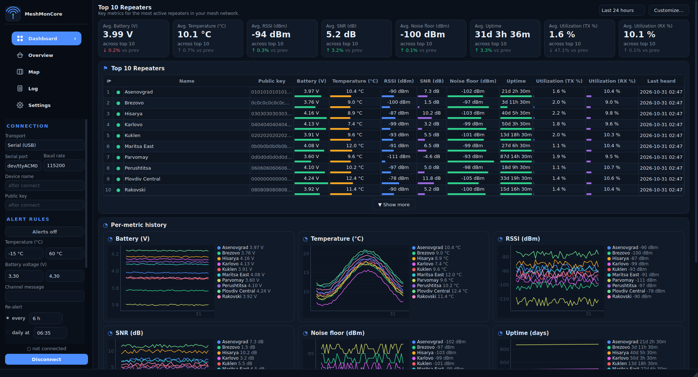
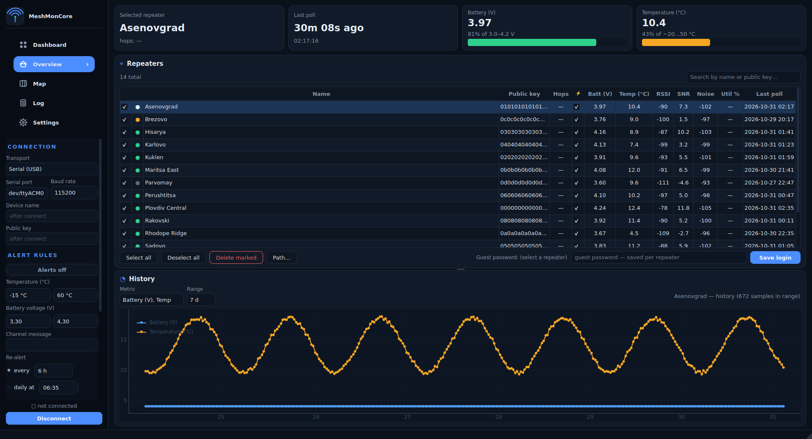
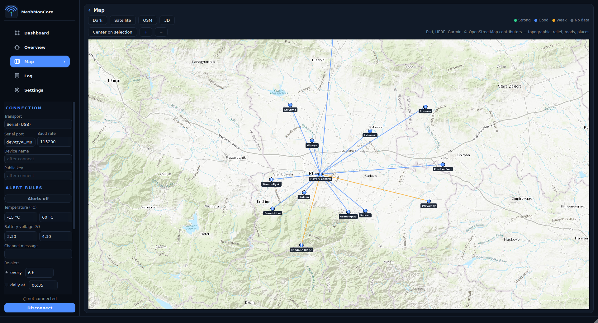

# MeshMonCore

Desktop monitor for [MeshCore](https://github.com/meshcore-dev/MeshCore) repeater
meshes: polls repeaters over the companion link (serial USB or TCP), stores
history in SQLite, and shows a dashboard of battery voltage, temperature,
RSSI/SNR, noise floor, airtime utilization and uptime — with alerting to a
channel and a slippy map with link lines and hover cards.

## Screenshots

**Dashboard** — top-10 repeaters (expandable), KPI tiles, per-metric charts:

**Overview** — repeater table with freshness dots, stat tiles and history:

**Map** — pins, RSSI link lines and hover cards on a topographic basemap:
(Your companion should have GPS coordinates set!)

## Requirements

- Linux (Debian/Ubuntu-family), Python 3.12
- `libxcb-cursor0` — required by Qt's xcb plugin; the PySide6 wheels don't
  bundle it (`sudo apt install libxcb-cursor0`); the AppImage build script
  fetches it automatically
- A MeshCore companion device reachable by serial (USB) or TCP

## Run from source

    ./run.sh

which creates a `.venv`, installs `requirements.txt` and runs
`python -m meshmoncore`. To do it manually:

    python3.12 -m venv .venv
    .venv/bin/pip install -r requirements.txt
    .venv/bin/python -m meshmoncore

## Build the AppImage

    ./build_appimage.sh

Builds a self-contained `MeshMonCore-x86_64.AppImage`: it bundles the
python3.12 interpreter, installs dependencies from PyPI into an AppDir and
packs it with appimagetool (downloaded on demand on first build). Requires
python3.12 with pip, and curl or wget.

## Data locations

- Config: `~/.config/MeshMonCore/MeshMonCore.conf` (QSettings)
- Database & map-tile cache: `~/.local/share/meshmoncore`
  (override with the `MESHMONCORE_DATA` environment variable)
- The first launch migrates the config and database from a pre-rename
  `meshmon` install automatically.

`meshmoncore/mock_device.py` is a tiny TCP mock of a companion device for
testing without hardware: `python3 -m meshmoncore.mock_device [port]`.

## Map data attribution

Basemap tiles © Esri (World_Dark_Gray_Base, World_Imagery, World_Topo_Map)
and © OpenStreetMap contributors; the in-app attribution line carries the
per-style credit.

## License

MIT — see [LICENSE](LICENSE). Third-party runtime dependencies remain under
their own licenses: PySide6/Qt (LGPLv3), pyqtgraph (MIT), meshcore (MIT),
Pillow (HPND). If you redistribute built AppImages, include those projects'
license texts alongside.
